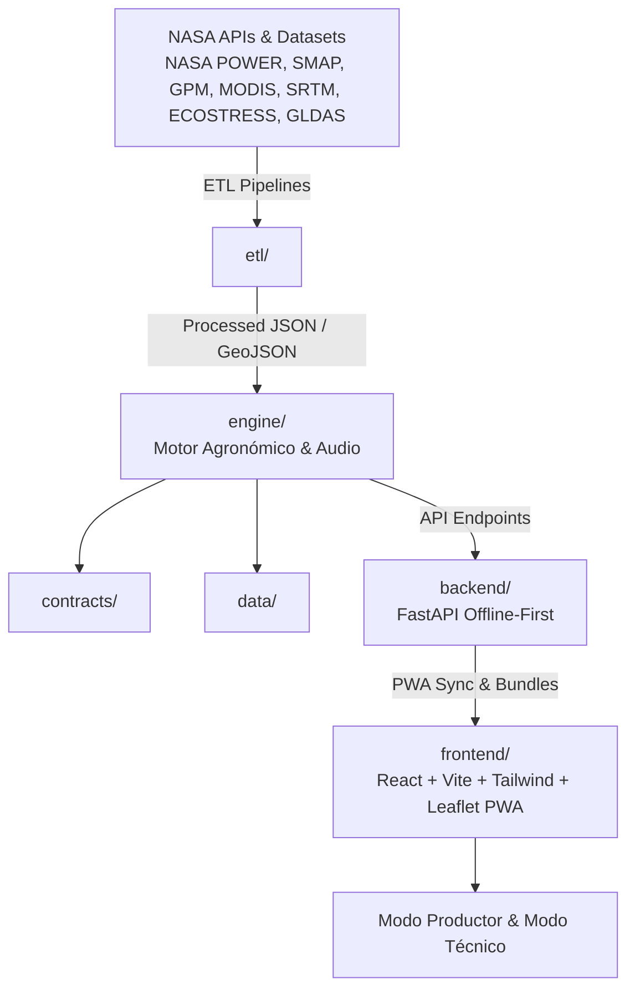

# Tarpuy NASA Cochabamba — Field Shift (NASA Space Apps 2026)

Plataforma tecnológica **offline-first y multimodal** (visual intuitiva + audio bilingüe Quechua/Español) que traduce datos satelitales y climáticos globales de la NASA (`NASA POWER`, `SMAP`, `GPM/IMERG`, `MODIS/Sentinel-2`, `SRTM`, `ECOSTRESS`, `GLDAS`, `FAO GAEZ`) en recomendaciones comparativas de rotación de cultivos (al menos 3 estrategias por parcela/zona) para pequeños productores de Cochabamba, Bolivia con conectividad limitada y baja alfabetización.

## 🏗️ Arquitectura General



Flujo: `etl/` (ingesta/procesamiento) -> `engine/` (lógica agronómica y cálculo de rotaciones/brechas) -> `backend/` (API FastAPI y generación de cartillas/bundles) -> `frontend/` (PWA offline-first con interfaz multimodal).

---

## 👥 Roles del Equipo y Estructura del Repositorio

La siguiente tabla detalla la distribución de carpetas y las ramas de trabajo sugeridas para los **6 miembros del equipo**:

| Rol / Miembro | Rama Git Sugerida | Carpetas / Archivos Propios | Descripción de Responsabilidades |
| :--- | :--- | :--- | :--- |
| **Rol 1** | `feat/etl-climate` | `etl/climate/`, `etl/nasa_power.py`, `etl/gpm_gldas.py` | Ingesta y normalización de datos climáticos de `NASA POWER`, `GPM/IMERG` y `GLDAS`. |
| **Rol 2** | `feat/etl-geospatial` | `etl/geospatial/`, `etl/smap_modis.py`, `etl/srtm.py` | Fusión espacial de `SMAP` (humedad de suelo), `MODIS/Sentinel-2` (NDVI), `SRTM` (topografía) y suelo desnudo. |
| **Rol 3** | `feat/engine-agronomy` | `engine/`, `data/crops_cochabamba.json`, `data/audio/` | Motor de comparación de 3+ rotaciones por parcela, análisis de evidencia, cálculo de brechas hídricas y generación de guiones/audios bilingües. |
| **Rol 4** | `feat/backend-api` | `backend/`, `contracts/` | Desarrollo de la API en `FastAPI`, endpoint `/api/offline-bundle/{zone_id}`, empaquetado de datos y generación de cartillas imprimibles en PDF. |
| **Rol 5** | `feat/frontend-producer` | `frontend/src/producer/`, Service Worker | PWA offline-first con Service Worker e `IndexedDB`, Modo Productor visual basado en íconos simplificados y reproductor de audio Quechua/Español. |
| **Rol 6** | `feat/frontend-technical-pitch` | `frontend/src/technical/`, `docs/` | Modo Técnico/Jurado con mapa interactivo `Leaflet`, gráficas analíticas avanzadas, reproducción de audios y documentación del Pitch y Video NASA Space Apps. |

---

## 🚀 Guía de Configuración y Flujo de Trabajo Git

### 1. Requisitos Previos
- **Python 3.13+**
- **Node.js 22+** (y npm / yarn / pnpm)
- Git instalado en el sistema.

### 2. Configuración Inicial del Entorno Local
```bash
# Clonar o abrir la carpeta del repositorio
cd C:\Users\Joel\.gemini\antigravity\scratch\tarpuy-nasa-cochabamba

# Configurar entorno virtual de Python
python -m venv .venv
# En Windows (PowerShell):
.venv\Scripts\Activate.ps1

# Instalar dependencias de backend/ETL y pruebas
pip install -r requirements.txt

# 1) Sincronizar telemetría real desde NASA POWER API
python -m etl.harmonizer

# 2) Ejecutar suite de pruebas (ETL, Motor Agronómico, FastAPI y OWASP)
pytest -v

# 3) Levantar Backend FastAPI (puerto 8000)
uvicorn backend.main:app --reload

# 4) En otra terminal, levantar Frontend PWA (puerto 5173)
cd frontend
npm install
npm run dev
```

### 3. Conexión con el Repositorio Remoto en GitHub y Git Flow
El repositorio sigue **Git Flow** (`main` ← `release/*` ← `develop` ← `feature/*`). Una vez creado el repositorio vacío en GitHub, vincularlo y subir ambas ramas y etiquetas:
```bash
git remote add origin <URL_DEL_REPOSITORIO_GITHUB>
git push -u origin main develop --tags
```

Para nuevas funcionalidades del equipo, crear ramas desde `develop` (`git checkout -b feature/<nombre> develop`), mantener commits modulares ($\le 250$ líneas) y fusionar hacia `develop`.
